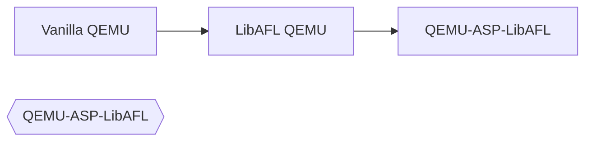

# QEMU-ASP-LibAFL

Implementing the ASP on top of the libafl-qemu-bridge.

## Structure



### Repos
- [Vanilla QEMU](https://github.com/qemu/qemu)
- [AMD SP QEMU](https://github.com/pascalharp/qemu)
- [LibAFL QEMU](https://github.com/AFLplusplus/qemu-libafl-bridge)

## Usage

### Build

```bash
mkdir build && cd build
../configure.sh
make qemu-system-arm
```

### Run

```bash
./qemu-system-arm \
--machine amd-psp-zen2 \
-device loader,file=$PATH_TO_ON_CHIP_BL,addr=0xffff0000,force-raw=on \
-global driver=amd_psp.smnflash,property=flash_img,value=$FLASH_IMAGE
```

For integration with our other tools you should also enable a GDB Server with `-s -S` and in case things aren't working as expected add `-d "guest_errors,trace:*"` to see the relevant error messages.

## License

This project extends the QEMU emulator, and our contributions to previously existing files adopt those files' respective licenses; the files that we have added are made available under the terms of the GNU General Public License as published by the Free Software Foundation, either version 2 of the License, or (at your option) any later version.
